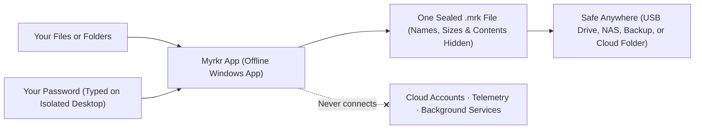
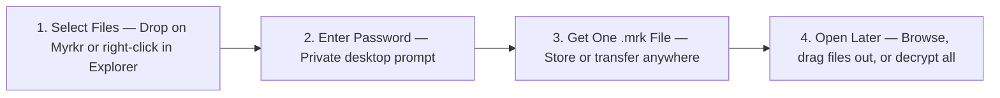

# Myrkr

**Lock a file or an entire folder behind one password on Windows—so nobody else can read it, and nobody can alter a single byte without you knowing.**

The name comes from Old Norse *myrkr*—darkness.

Drop files or folders onto the Myrkr window, type a password, and you get one sealed `.mrk` file back. Double-click that file later, enter your password, and your files return exactly as they were. There are no accounts, no cloud servers, no subscriptions, and no background services—just a fast, self-contained Windows app that stays completely offline.



---

## Why people choose Myrkr

- **Everything hidden inside one file**: Encrypting a folder of tens of thousands of files produces a single `.mrk` container. File names, file sizes, and folder structure are all encrypted inside it, so anyone without your password sees only one opaque file.
- **Tampering is caught automatically**: Secrecy alone is not enough—you also need to know nobody modified your backup. Flip even a single bit anywhere in a Myrkr container and Myrkr refuses to unpack it rather than handing back damaged files.
- **No back doors, no reset**: Only your password can unlock your container. There is no recovery server, vendor key, or hidden reset—which keeps your data yours alone, and means you must remember or safely store your password.
- **Small, fast, and self-contained**: Built directly for 64-bit Windows with zero external libraries, frameworks, or installers required to run. It handles large files smoothly in streaming chunks and stays silent when closed.
- **Designed for long-term safety**: Myrkr avoids the public-key handshakes that future quantum computers are expected to break, relying strictly on memory-hard password protection and 256-bit symmetric encryption sized with room to spare.
- **Earned trust you can check**: Every release is reproducible byte-for-byte and checked by automated safety gates. Read **[Why Myrkr Earns Trust](docs/TRUST.md)** for the full design and verification story.

---

## How everyday use works



### Install or run

Install for all users on your PC (adds a Start Menu shortcut, the `.mrk` file icon, and Windows Explorer right-click / right-drag menus):

```powershell
msiexec /i myrkr-<version>.msi
```

Or run `myrkr.exe` directly as a standalone app with nothing else to install.

### Encrypt, browse, and unpack

1. **Encrypt**: Open Myrkr and drop files or folders onto the window (or click **Add files** / **Add folder**), enter a strong password, and press **Encrypt**.
2. **Open, mount & unpack**: Double-click any `.mrk` file (or `.tc` / `.hc` TrueCrypt/VeraCrypt volume, or click the **Open TrueCrypt/VeraCrypt container** drive button on the command bar) to view its contents. Browse them as a read-only Windows drive letter in File Explorer (automatic for `.tc`/`.hc`, or one click on the **Mount as read-only drive** command-bar button for `.mrk`), press **Extract all** / **Extract selected**, or **drag individual files straight out**.
3. **Edit safely**: Adding or removing files inside an open `.mrk` container writes a freshly encrypted replacement container so backups and edited copies stay cryptographically independent.
4. **Use directly from Windows Explorer**: Select any number of files or folders and **right-click** (places output beside the original) or **right-drag** onto a destination folder or drive:
   - **Myrkr encrypt** for files and folders
   - **Myrkr decrypt** when `.mrk` containers are selected
   - **Myrkr extract** when `.zip` archives are selected

---

## Everyday capabilities at a glance

| Need | How Myrkr handles it |
|---|---|
| **Protect password & screen privacy** | Prompts for your password on a private Windows desktop that ordinary apps cannot inspect, and hides Myrkr windows from standard screenshots and screen-sharing by default. |
| **Split across drives or discs** | Turn on **File split** (`100 MB`, `700 MB`, `2 GB`, `4 GB`, `25 GB`, or `100 GB`) when saving to size-limited media (`name.part001.mrk`, `name.part002.mrk`, …). Opening *any* part reassembles and verifies the whole set ([details](docs/VOLUMES.md)). |
| **Share with people without Myrkr** | Switch **Format → Zip** in Settings to create password-protected `.zip` archives compatible with 7-Zip and WinZip, or open encrypted `.zip` files directly in Myrkr. |
| **Open & mount TrueCrypt & VeraCrypt volumes** | Open `.tc` and `.hc` containers (or any container chosen via the command-bar drive button) strictly **read-only** in user mode—no kernel drivers or elevation—automatically mounting a session drive letter for File Explorer across all ciphers/cascades, keyfiles, and `FAT12/16/32`, `exFAT`, `NTFS`, `ext2/3/4`, and macOS `HFS+` filesystems. |
| **Large folders & long paths** | Streams large files without loading them into memory at once, supports extended Windows paths, and stores relative archive paths up to 4,094 bytes ([path guide](docs/PATH_LIMITS.md)). |
| **Safe command-line inspection** | Inspect, verify, benchmark, hash, or run built-in self-tests (`myrkr --help`, `myrkr selftest`). Password-taking actions intentionally require the interactive prompt so Myrkr cannot be silently scripted across a network ([CLI guide](docs/CLI.md)). |
| **Team & IT deployment** | Deploy silently via MSI with either user-adjustable defaults (`MYRKR_DEF_*`) or locked organization policies (`MYRKR_*`) ([deployment guide](docs/DEPLOYMENT.md)). |

---

## Built for earned trust

Good security software explains both **what it protects** and **what depends on you**:

- **Protected on disk, in memory, and on screen**: Containers are locked with memory-hard key derivation and authenticated encryption, secret buffers are wiped immediately after use, and extracted files are verified before taking their final names on disk.
- **Continuously verified**: Every build passes static code analyzers, built-in cryptographic self-tests, independent container decryption checks, fault-injection tests, and reproducible-build verification.
- **Practical habits that matter**: Choose a strong, unique password and keep it somewhere safe (nobody can recover a forgotten password), keep backups of important `.mrk` files, and remember that once you decrypt files to a folder they become ordinary readable files on that PC.

Read **[Why Myrkr Earns Trust (`docs/TRUST.md`)](docs/TRUST.md)** and **[Security & Threat Model (`docs/SECURITY.md`)](docs/SECURITY.md)** for full technical details and commands to verify everything yourself.

---

## Where to go next

| If you want to… | Read |
|---|---|
| Understand why Myrkr is trustworthy and how every safeguard is verified | **[Why Myrkr Earns Trust](docs/TRUST.md)** · [Security & threat model](docs/SECURITY.md) |
| Use command-line inspection verbs, exit codes, and audit logs | [Command-line guide](docs/CLI.md) |
| Split large containers across multiple files or removable media | [Multi-volume guide](docs/VOLUMES.md) · [Path limits](docs/PATH_LIMITS.md) |
| Roll out Myrkr across managed Windows PCs with defaults or locked policies | [Deployment & MSI guide](docs/DEPLOYMENT.md) |
| Dive into the container wire format, cryptography, assembly modules, and tests | [Technical manifest](manifest.md) · [Test suite overview](tests/README.md) · [Security test plan](docs/security-testing.md) |
| Browse every reference document, design record, and release note | [Documentation map](docs/README.md) · [Release history](CHANGES.md) |

## AI-assisted development

Myrkr is developed using AI. Anthropic Opus 4.8-5.5, Fable 5-5.1, Moonshot Kimi K3, ChatGPT 6 Astra, and Google Gemini 4 Carbon have all contributed to the code, quality, and security—backed by deterministic builds, independent reference verifiers, and automated test gates on every change.
