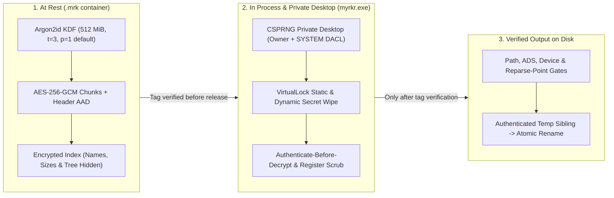
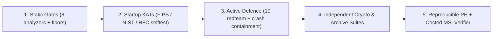

# Why Myrkr Earns Trust

[Project overview](../README.md) · [Documentation map](README.md) · [Security & threat model](SECURITY.md) · [Technical reference](../manifest.md) · [Deployment & policy](DEPLOYMENT.md)

Trust in an encryption tool is earned through an architecture that removes whole classes of failure by construction, explicit boundaries, and automated verification that anyone can run offline.

---

## 1. Why the architecture was designed this way

Many encryption tools depend on large third-party software stacks, background services, or cloud accounts. Each layer widens the surface that can fail or leak plaintext.

Myrkr takes the opposite path:

| Architectural decision | Failure classes eliminated by construction | Where enforced |
|---|---|---|
| **Offline, single-purpose executable** | Remote server breaches, key-sync interception, telemetry leaks, and compromised update channels. Myrkr links zero networking libraries (`ws2_32`, `winhttp`, and `wininet` are absent). | Import table & [`build.cmd`](../build.cmd) |
| **Zero third-party libraries or C runtime** | Supply-chain compromises in external packages, garbage-collector copies of secrets in RAM, and runtime library vulnerabilities. Forty-nine x64 assembly modules link exclusively against Windows `System32` DLLs. | `src/loadcfg.asm` (`DependentLoadFlags = 0x0800`), `src/hardening.asm` (`SetDefaultDllDirectories`), [`tools/pe_normalise.py`](../tools/pe_normalise.py) |
| **Non-scriptable password boundary** | Fleet-wide scripted abuse of an approved binary. Release builds refuse `-p` on the command line and prompt on an isolated Windows desktop by default. | `src/cmd.asm`, `src/secdesk.asm`, [`tools/make_msi.ps1`](../tools/make_msi.ps1) |
| **Authenticated `.mrk` container** | Unauthenticated metadata tampering, header parameter spoofing, silent corruption, and nonce reuse across edited copies. Every byte—including the header (`AAD`), encrypted file index, and streamed payload chunks—is authenticated before release, and native edits re-encrypt the entire container under a fresh salt and key. | `src/aesgcm.asm`, `src/pack.asm`, [`tests/indepdecrypttest.py`](../tests/indepdecrypttest.py), [`tests/nonceforktest.py`](../tests/nonceforktest.py) |
| **Byte-for-byte reproducible builds** | Unverifiable release binaries. Two clean builds of the same commit produce identical `myrkr.exe` and `myrkrshell.dll` images with ASLR, DEP/NX, high-entropy VA, and CET shadow-stack flags preserved. | [`tools/pe_normalise.py`](../tools/pe_normalise.py), [`tools/verify_repro.ps1`](../tools/verify_repro.ps1) |

---

## 2. How secrets and files are protected across their lifecycle

### Cryptographic & container guarantees
- **Memory-hard key derivation**: Passwords pass through **Argon2id** (RFC 9106; default `512 MiB` RAM, `3` passes, `1` lane; reader enforces `1..16` passes and `8,192..4,194,304 KiB` bounds before allocation, while retaining backward-compatible reader support for format v6–v8 containers). A 16-byte `SHA-256` key-check value rejects wrong passwords in ~0.7 s using constant-time comparison (`ct_memcmp`).
- **Authenticate-before-decrypt AES-256-GCM**: One-shot `gcm_open` verifies the GHASH authentication tag over ciphertext and `AAD` before writing a single byte to the output buffer (`src/aesgcm.asm`), enforcing NIST SP 800-38D input length limits (`plaintext <= 2^36 - 32` bytes). Key expansion uses hardware `aeskeygenassist` instructions with zero lookup tables in RAM and rejects key lengths outside `{16, 24, 32}` bytes.
- **Unique salts, segmented counter nonces & fork-safe edits**: Every container draws a fresh 32-byte salt from `BCryptGenRandom`. GCM nonces combine entry/chunk counters with a 32-bit segment index (`nonceforktest.py --segments`), and native container edits (`add` / remove) stream plaintext in memory into a newly salted, freshly keyed container so copied or restored backups never share key-nonce pairs.
- **Post-quantum symmetric margin**: Myrkr uses zero public-key primitives (no RSA, ECC, or Diffie–Hellman), leaving nothing exposed to Shor's algorithm, and pairs Argon2id with 256-bit AES keys sized against Grover's quadratic speed-up ([`SECURITY.md` §3.1](SECURITY.md#quantum-resistance)).
- **Hardened WinZip AE-2 `.zip` interoperability**: When reading or writing interoperable AES `.zip` archives (`src/zip.asm`, `src/unzip.asm`), Myrkr enforces Zip64 sentinel resolution, cross-checks Local File Header compression/encryption fields against the Central Directory, caps buffer allocations to archive bounds (`zipclaimtest.py`), and wipes HMAC-SHA1/PBKDF2/AES key schedules on exit.
- **User-mode, read-only TrueCrypt (`.tc`) & VeraCrypt (`.hc`) reader**: Myrkr opens standard non-hidden TrueCrypt 7.1a and VeraCrypt file containers strictly read-only (`GENERIC_READ`, `asInvoker`, zero kernel drivers) across all 5 ciphers (`AES-256`, `Serpent-256`, `Twofish-256`, `Camellia-256`, `Kuznyechik`), all 15 XTS single/cascade modes, all 7 header KDFs (`PBKDF2-HMAC` over `SHA-512`/`SHA-256`/`BLAKE2s-256`/`Whirlpool`/`Streebog-512`/`RIPEMD-160` plus VeraCrypt `Argon2id`), keyfiles, and 5 user-mode filesystem readers (`FAT12/16/32`, `exFAT`, `NTFS`, `ext2/3/4`, and macOS `HFS+`). Key schedules live inside `VirtualLock`ed `secmem`, passwords and keyfile pools are scrubbed immediately after header unlock, and every filesystem reader enforces strict volume-sector bounds, cluster/extent/B-tree cycle ceilings, OS volume metadata filtering, and symlink/reparse-point filtering.
- **User-mode, read-only Cloud Files drive mounting**: Both `.tc`/`.hc` volumes (automatically on GUI open) and native `.mrk` containers (via the `ID_MOUNTDRV` command-bar toggle) can be mounted as standard read-only Windows drive letters (`Z:` downward) without elevation or third-party kernel drivers (`src/cfmount.asm`, linking inbox `cldapi.dll` via `LOAD_LIBRARY_SEARCH_SYSTEM32` + session `DefineDosDeviceW`). Sync-root directories under `%LOCALAPPDATA%\Myrkr\Mounts` carry `FILE_ATTRIBUTE_NOT_CONTENT_INDEXED`, native `.mrk` streams authenticate AES-256-GCM tags before completing hydration (`STATUS_DATA_CHECKSUM_ERROR` on tamper), `NOTIFY_FILE_CLOSE_COMPLETION` dehydrates placeholders back to `0` on-disk bytes (`CfDehydratePlaceholder`), and startup/shutdown sweeps unregister, zero-wipe, and unmap stale mounts.

### Process, memory, desktop & I/O defense-in-depth
- **CPU gate & process mitigations**: Startup (`src/main.asm`, `src/hardening.asm`) verifies `AES-NI`, `PCLMULQDQ`, and `SSE4.1`, checks `OSXSAVE` + `XCR0` (`XMM` + `YMM` OS state) before enabling `AVX2`, provides a constant-structure software `SHA-256` fallback when `SHA-NI` is absent (`src/sha256.asm`), and enables `HeapEnableTerminationOnCorruption`, `SetDefaultDllDirectories(LOAD_LIBRARY_SEARCH_SYSTEM32)`, `ProcessExtensionPointDisablePolicy`, and `ProcessImageLoadPolicy` (`NoRemoteImages`).
- **Locked secret regions & dynamic panic wipe**: `secmem_init` (`src/secmem.asm`) `VirtualLock`s static key, password, Argon2/BLAKE2b, and WinZip-AES buffers in physical RAM (`selftest` verifies working-set residency via `QueryWorkingSetEx`), while `secmem_register_range` tracks dynamic secret arenas (`g_arena`) so fatal faults scrub live working memory as well. Argon2 wipes `H0` (`g_hbuf`) immediately after lane seeding, and crypto primitives scrub stack frames plus volatile `xmm`/`ymm` (`vzeroupper`) registers before returning.
- **Control-flow, stack & heap integrity**: Linked `/CETCOMPAT` for hardware shadow stacks and paired with a per-thread TLS software shadow stack (`FRAME_PROLOG` / `FRAME_EPILOG` verifying strict top-of-stack equality and ancestor integrity, flushed against an upper `PAGE_NOACCESS` guard page), per-process stack cookies, 8-byte `DLPV` landing pads on internal indirect calls, read-only IAT lockdown after startup, and canary-tagged heap blocks (`tagged_alloc` / `tagged_free`) that bound zeroing to allocated capacity and poison freed blocks (`0xDD`).
- **Crash containment**: Unhandled faults inside Myrkr (`src/hardening.asm`) atomically latch `g_in_crash`, wipe all static and dynamic registered secrets first, switch back from the private desktop, exclude the process from Windows Error Reporting (`WerSetFlags` + `WerAddExcludedApplication`), and terminate via `__fastfail` (emitting `%TEMP%\myrkr_crash.bin` only in `DBG_TRACE` diagnostic builds).
- **Isolated desktop, screen-capture & IME protection**:
  - **Private password desktop**: `secdesk.asm` creates a per-prompt 128-bit CSPRNG-named desktop (`Myrkr-<32 hex>`) with minimal `DESKTOP_CREATE_ACCESS` rights and applies an explicit `SE_DACL_PROTECTED` DACL granting `TokenUser` (`0x00020146`, stripping `DESKTOP_HOOKCONTROL` and `DESKTOP_READOBJECTS` inherited from `WinSta0`) plus `SYSTEM` (`S-1-5-18`), Window Manager (`S-1-5-90-0`), and Font Driver Host (`S-1-5-96-0`) (`GENERIC_ALL`), failing closed if CSPRNG or ACL setup fails. A 5-minute watchdog (`MsgWaitForMultipleObjects`) prevents stranded desktops.
  - **Window capture & IME hardening**: All Myrkr top-level windows enable `SetWindowDisplayAffinity(WDA_EXCLUDEFROMCAPTURE)` by default (`AllowScreenCapture = 0`), detach IME (`ImmAssociateContext(hwnd, 0)`) from password `EDIT` controls, and run a 3-step `EM_SETLIMITTEXT` / overwrite / `EM_EMPTYUNDOBUFFER` scrub before destroying password controls.
- **Filesystem, path & policy gates**:
  - **Pre- and post-open file validation**: `normalize_path` (`src/cmd.asm`) and `fileio.asm` (`file_path_allowed`, `file_leaf_surrogate`, `file_validate_handle`) collapse `.` and `..` segments, reject `< 0x20`/`0x7F` control bytes, Windows device namespaces (`\\.\`, `\\?\GLOBALROOT`), NTFS `:stream` alternate data streams, non-`FILE_TYPE_DISK` handles, and name-surrogate reparse points (`0x20000000`—blocking symlinks, junctions, and mount points while keeping OneDrive cloud-file hydration intact).
  - **Safe audit logging**: Default log paths resolve from the process token via `GetUserProfileDirectoryW` (`\AppData\Local\Myrkr\myrkr.log`) rather than mutable environment variables, scrub C0/DEL log-injection characters, and validate log handles with `FILE_FLAG_OPEN_REPARSE_POINT`.
  - **Fail-closed enterprise policy**: `HKLM\SOFTWARE\Myrkr` enforces `REG_DWORD` type/size validation and fails closed (`SecureDesktop = 1`, `AllowScreenCapture = 0`, `AllowUnc = 0`, or clamped floor) with the UI control locked even if a registry value is malformed or out of range.

---

## 3. How trust is verified (run it yourself)

Every guarantee above is checked by automated offline gates in `build.cmd` and `tests\run.ps1`:

| Verification layer | What it proves | Command to reproduce |
|---|---|---|
| **8 static source, ABI & doc analyzers** | Verifies Win64 stack frames and raw `WNDPROC` callbacks (`framecheck --strict`), callee-saved GP/XMM registers and `vzeroupper` (`nvcheck`), `WINCALL` register clobbers (`wincallcheck`), mirrored constants and 7-site version sync (`constcheck`), bounded wide-string copies (`wstrcheck`), alignment (`aligncheck`), dead symbols (`deadcode`), markdown links/fences (`check_docs`), and `System32` `DependentLoadFlags` (`pe_normalise`)—backed by [`tools/floors.py`](../tools/floors.py). | `build.cmd strict release` |
| **Built-in cryptographic & runtime self-tests** | Validates AES-128/192/256, AES-256-GCM (including untouched-output buffer on bad tag), AES-256-XTS (IEEE P1619), Serpent-256, Twofish-256, Camellia-256, Kuznyechik, SHA-256, SHA-512, BLAKE2s-256, RIPEMD-160, Whirlpool, Streebog-512, TC/VC CRC-32 keyfile mixing, SHA-1, HMAC-SHA1, PBKDF2, BLAKE2b, Argon2id (RFC 9106 + 64 MiB vector + parameter rejection), DEFLATE/inflate, UTF-8 password policy, traversal sanitization, `VirtualLock` working-set residency, and live private-desktop creation, peer-hook denial, and worker attachment. | `bin\myrkr.exe selftest` |
| **Independent container & nonce verifiers** | Standalone Python reader (`indepdecrypttest.py`, using its own RFC 9106 Argon2id and pure-Python AES-256-GCM) independently decrypts Myrkr containers, and `nonceforktest.py` proves segment-counter isolation and zero key/nonce reuse across native edits. | `python tests\indepdecrypttest.py` and `python tests\nonceforktest.py --segments` *(on `dbg`/`testio` build)* |
| **Active-defence fault injection** | Deliberately triggers all 10 runtime traps—stack cookie, shadow-stack top and ancestor corruption, DLPV landing pad, arithmetic overflow, bounds check, heap tag, type magic, read-only IAT, and crash containment—asserting exact `0xFADExxxx` / `0xC0000409` exit codes. | `python tests\redteam.py` and `python tests\crashtest.py` *(on `dbg` build)* |
| **Adversarial archive, hazard & GUI suites** | Exercises GCM and WinZip-AES tamper matrices (`secsuite.py`), Zip64/NUL/oversized bounds (`zipboundstest.py`), 3 GiB spoofed-size working-set cap (`zipclaimtest.py`), 4,094-byte paths (`longnametest.py`), junction/hardlink extraction hazards (`extracthazardtest.py`), TrueCrypt/VeraCrypt XTS + 5-filesystem functional & adversarial fuzz suites (`tcvctest.py`, `tcvcfuzz.py`, `tcvcguitest.ps1`), user-mode Cloud Files mount/dehydrate/tamper checks (`cfmounttest.ps1`), and live Win32 GUI/private-desktop tests. | `powershell -NoProfile -ExecutionPolicy Bypass -File tests\run.ps1` |
| **Reproducible build & MSI costed verifier** | Rebuilds from clean objects twice to prove byte-identical `myrkr.exe` and `myrkrshell.dll` hashes, then builds and costs the per-machine MSI across policy, default, upgrade, downgrade-block, and type-coercion `LaunchCondition` gates. | `powershell -NoProfile -ExecutionPolicy Bypass -File tools\verify_repro.ps1` and `tools\verify_msi.ps1` |

---

## 4. Honest boundaries

Credible security documentation states what lies outside a user-mode encryption tool's reach:

- **No external third-party audit recorded**: All source code, specifications, and verification suites in this repository are open and reproducible offline, but no independent third-party audit has been commissioned.
- **Password strength & zero recovery**: Argon2id makes each guess expensive (`512 MiB` RAM, `3` passes by default), yet a weak or reused password remains vulnerable to offline guessing. Because Myrkr has no server, escrow, or recovery key, a forgotten password makes encrypted data permanently unrecoverable.
- **Compromised endpoint, administrator, or hardware**: User-mode `VirtualLock`, private-desktop isolation, screen-capture exclusion, and memory scrubbing cannot defeat a malicious kernel driver, same-user/administrator debugger, hardware keylogger, DMA/cold-boot attack, or unencrypted OS hibernation (`hiberfil.sys` without full-disk encryption).
- **Plaintext after extraction**: Myrkr authenticates entries in temporary siblings before renaming them into place, so unverified bytes never take the target filename. Once extracted, however, decrypted files are ordinary files on disk governed by Windows filesystem permissions, and a multi-file extraction that aborts mid-way leaves previously verified files in the destination folder with a clear failure warning.
- **Configurable policy trade-offs**: Administrators can relax specific defaults for operational compatibility—such as `MYRKR_SECUREDESKTOP=0` for interactive-desktop screen readers, `AllowScreenCapture=1` for remote support capture, or `AllowUnc=1` (default `1` for NAS shares, lockable to `0` via `MYRKR_ALLOWUNC=0`). Each trade-off is documented in [`DEPLOYMENT.md`](DEPLOYMENT.md) and [`SECURITY.md`](SECURITY.md).
- **XTS disk encryption vs. authenticated `.mrk` containers**: Native `.mrk` containers authenticate every header and payload byte with AES-256-GCM before releasing plaintext. By contrast, the TrueCrypt/VeraCrypt disk-volume format uses **XTS** mode (labeled `Read-Only (XTS)` in the status bar): header unlock verifies `"TRUE"`/`"VERA"` magic and header/key-set CRC-32 checksums, but XTS data sectors carry no per-sector MAC, so an adversary who flips ciphertext bytes in a `.tc`/`.hc` data region can corrupt the corresponding 16-byte/512-byte plaintext block without cryptographic tag rejection. Use `.mrk` whenever tamper detection is required.
- **Unsigned reproducible binaries**: Release builds are deterministic (`bin\SHA256SUMS.txt`), but binaries are not Authenticode-signed by a commercial certificate authority.
